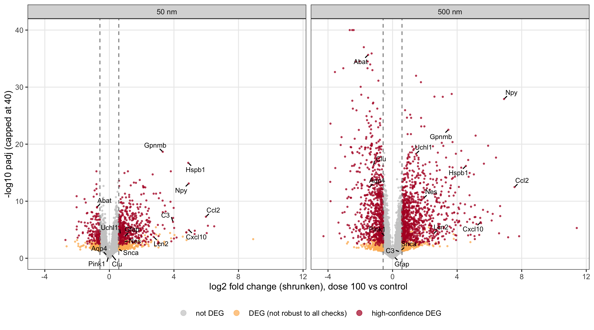
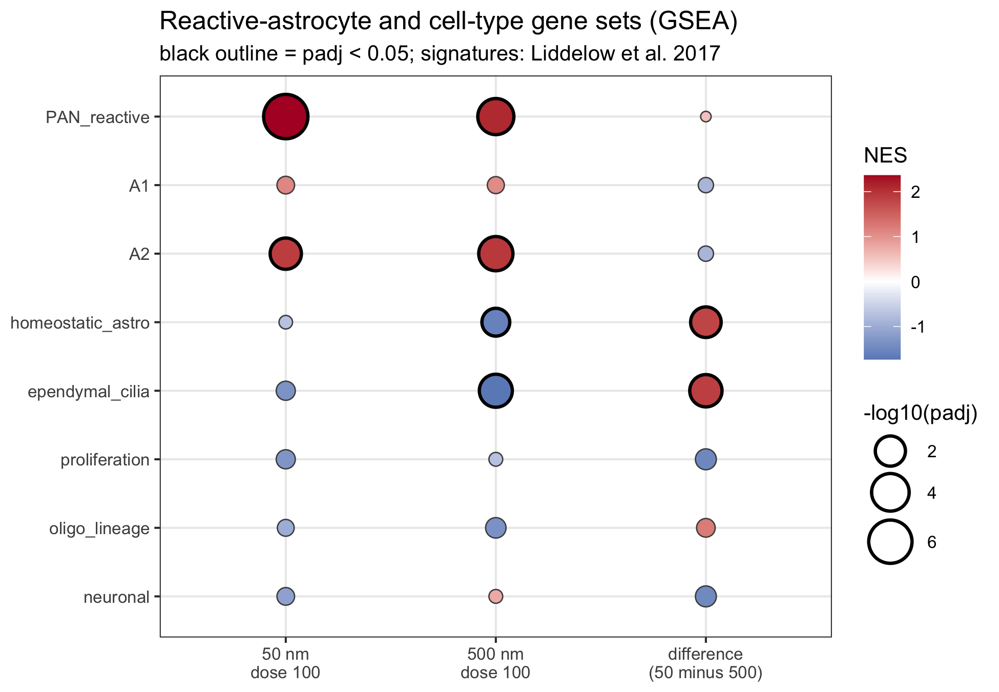
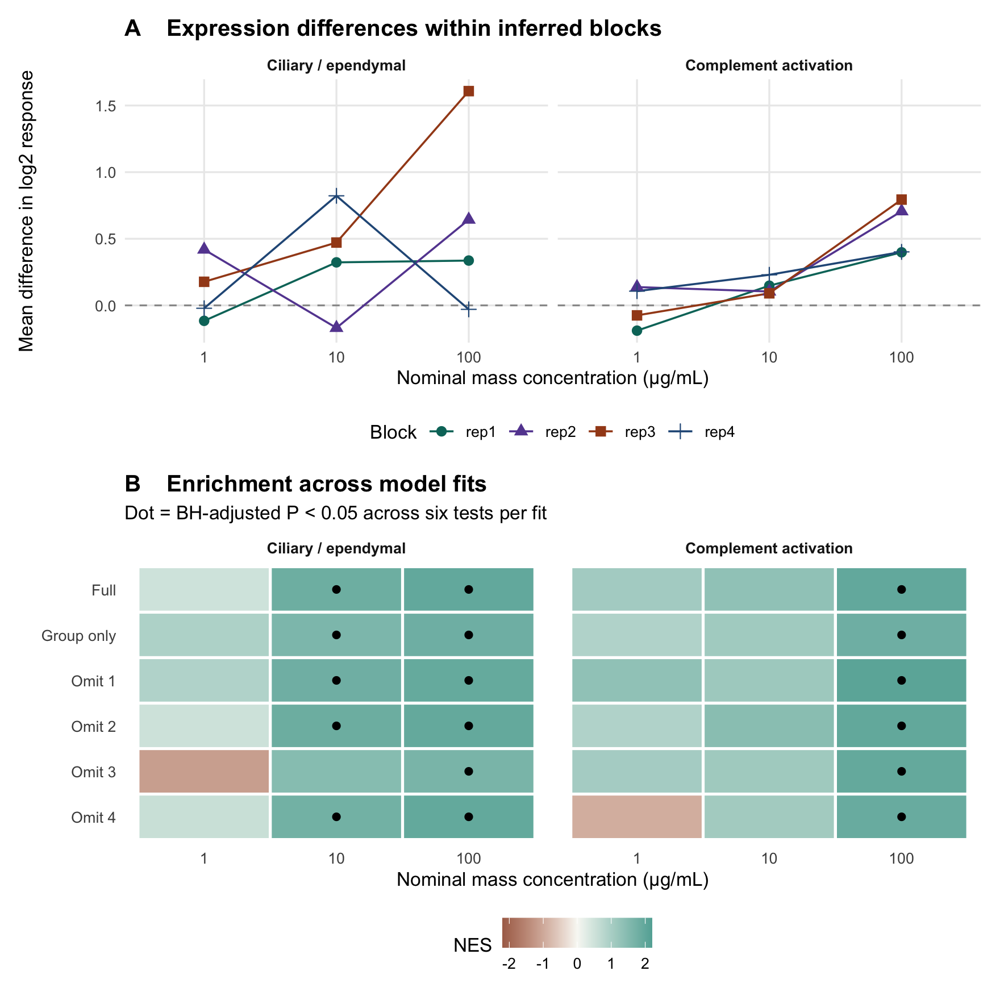

Mohammad Javad Eslami

Independent researcher, Tehran, Iran

Correspondence: Mohammad Javad Eslami, mohamadjavadeslami10@gmail.com

## Abstract

**Background** Repeated exposure to polystyrene particles alters inflammatory gene expression in rat astrocyte cultures. Whether the magnitude or direction of the response differs between particle sizes requires a direct comparison at the same mass concentration.

**Results** We reanalysed 32 libraries from cultures exposed for seven days to 50 nm or 500 nm particles. At each concentration, we compared the change from control in one particle series with the change in the other. At 100 µg/mL, 990 genes met a 5% false discovery rate in a model that included an inferred sample block. Of these, 144 retained significance after omitting each block in turn and showed the same direction in all four individual blocks. A model without blocking identified 89 genes, including 50 of the 144. In a targeted follow-up, ciliary and ependymal markers showed a greater relative decline in the 500 nm series, and complement-related transcripts shifted toward the 50 nm response. Both enrichments persisted without blocking and after each block omission. At 10 µg/mL, ciliary enrichment remained positive in all six fits, but omission of one block raised the adjusted P value from 0.0056 to 0.161. At 1 µg/mL neither set reached significance.

**Conclusions** At the highest concentration, the two particle series elicited distinguishable ciliary and complement expression profiles across model specifications. Individual gene discovery counts were more sensitive to blocking. The bulk measurements leave open whether the ciliary signal arose from altered transcription within cells, changes in culture composition or both.

**Keywords** Polystyrene, astrocyte cultures, RNA sequencing, nanoplastics, microplastics, cilia, complement, transcriptomics

## Background

Marcellus and colleagues found that repeated exposure to polystyrene particles altered inflammatory and metabolic gene expression in rat neural stem cell-derived astrocyte cultures [1]. At 100 µg/mL, they reported 531 differentially expressed genes for the 50 nm series and 1,274 for the 500 nm series. These counts describe each exposure relative to its own control. They leave a separate question open: for which genes or gene sets does the change from control differ between the two series? The public sequencing libraries and published gene tables allow that contrast to be estimated directly [2].

A distinction between shared and divergent responses is biologically relevant in this culture system. Inflammatory and stress responses have also been observed in primary human astrocytes exposed to polystyrene under different conditions [3]. The interpretation of ciliary transcripts is less straightforward. In the postnatal mouse brain, *Foxj1* contributes to ependymal differentiation and marks a subset of astrocytes [4]. In a bulk culture, a decrease in *Foxj1* and associated transcripts can therefore reflect a change in marker expression, a change in the representation of marker-positive cells, or both.

We asked whether equal nominal mass concentrations of the two particle sizes produced different transcriptional responses after seven days. A recurring suffix in the sample records suggested a possible block shared across exposure groups. We examined how the choice of model affected gene-level discoveries, then followed ciliary and complement expression across doses and individual blocks. The gene sets were selected after examining the high-dose data, so the dose-specific analyses are exploratory.

## Methods

### Source material and sample structure

GSE256038 comprises paired-end libraries from rat fetal neural stem cell-derived astrocyte cultures exposed to polystyrene for seven days [1,2]. Each series (50 nm and 500 nm nominal diameter) comprised a control and exposures at 1, 10 and 100 µg/mL, with four libraries per group. All 32 libraries were retained. The sample size was fixed by the source experiment. The original study reported four samples for RNA extraction and three independent experiments for the separate viability assay [1].

Each GEO sample was linked to its SRA run and BioSample accession. Within each of the eight groups, BioSample titles carried the suffixes 01–04, matching the order of the GEO accessions. These suffixes defined four inferred blocks. The available metadata did not establish whether a suffix denoted a shared culture, preparation day or technical batch. Principal component analysis used the 500 most variable genes after variance stabilization. Separate regressions of component scores on suffix assessed their association.

### Quantification and comparison with the published analysis

The two FASTQ files per library were verified against ENA MD5 checksums. FastQC and fastp provided per-file and per-library quality reports, which were aggregated with MultiQC [5,6]. Salmon 2.8.0 quantified the paired reads with automatic library-type detection and sequence- and GC-bias correction [7]. The index contained Ensembl release 116 rat cDNA and noncoding RNA sequences (GRCr8, k = 31), without genomic decoys. Transcript identifiers were matched to the same release’s gene annotation after removal of version suffixes. Gene-level counts and sample-specific transcript-length offsets were imported with tximport 1.40.0 [8]. Genes with at least ten counts in at least four libraries entered the DESeq2 1.52.0 analysis [9].

The blocked negative-binomial model included an eight-level exposure group and a four-level block as additive fixed effects. A group-only model used the same libraries and filtered gene universe. Within each series, high-dose discoveries required a Benjamini–Hochberg (BH) adjusted Wald P value below 0.05 and an absolute apeglm-shrunken log₂ fold change of at least log₂(1.5) [10,11]. Published genes were matched by Ensembl identifier, with unique gene symbols as a fallback when identifiers were absent from the updated annotation. Ambiguous matches and symbol matches conflicting with a direct identifier match were excluded. Recovery was calculated among published discoveries represented in the comparison. For the within-series stability display in Fig. 1, highlighted genes also retained significance and direction in all four block-omission fits and agreed in direction within every observed block.

We shuffled the four suffix labels independently within each group and refitted DESeq2 for 39 draws (seed 20261113). Each fit retained the same group composition and number of block parameters. Observed and shuffled fits used identical contrast extraction and a BH threshold of 0.05 alone. This comparison assessed whether the observed suffix arrangement captured expression structure in these samples.

### Differences between exposure responses

At each nonzero dose, the gene-level contrast was (50 nm exposure − 50 nm control) − (500 nm exposure − 500 nm control) on the log₂ scale. Positive estimates indicate that the signed transcriptional response was greater in the 50 nm series. Direct contrasts used unshrunken coefficients, DESeq2 independent filtering and BH adjustment within each contrast. Pointwise 95% Wald intervals describe uncertainty in individual coefficients. A three-degree-of-freedom likelihood-ratio test compared a block + series × categorical dose model with a reduced model containing block, series and dose main effects.

Each block-omission fit retained 24 libraries and the original gene universe. Normalization and dispersions were re-estimated. Descriptive within-block contrasts were calculated from log₂(normalized count + 0.5). We recorded sign agreement separately from significance and compared the blocked-model discoveries with those from the group-only model. Sensitivity to low abundance was assessed by restricting reported results to genes with a full-model mean normalized count of at least 10, 20 or 50 after multiple-testing adjustment.

### Gene sets and sensitivity analyses

Exploratory analyses examined Gene Ontology biological processes, KEGG pathways and a panel of eight astrocyte and cell-type marker sets. The latter included pan-reactive and historical A1 and A2 marker lists derived from mouse experiments [12]. Within each high-dose contrast, the panel analysis ranked mapped genes with evaluable adjusted P values by a Wald statistic reconstructed from the exported effect estimate and standard error. The ciliary/ependymal set and the complement activation term (GO:0006956) were selected for targeted follow-up. Membership is archived with the analysis. Complement members were obtained from the rat annotation package org.Rn.eg.db, including genes annotated to descendant terms.

For the targeted analysis, preranked gene-set enrichment analysis (GSEA) used clusterProfiler and full-precision, finite DESeq2 Wald statistics [13,14]. Where multiple gene identifiers shared a symbol, the entry with the largest absolute statistic was used, with identifier order breaking ties. We tested sets of 4–500 represented genes. Seven ciliary and 18 complement members were represented. BH adjustment covered both sets at all three nonzero doses separately within each model fit. A positive normalized enrichment score (NES) denotes enrichment toward the 50 nm response. We examined the leading edge (members contributing to the enrichment peak), and repeated high-dose GSEA after removing each represented gene from its set. The 25 omission P values were adjusted together. Block-level scores in Fig. 3 are unweighted means of member-gene log₂ response differences. All omission analyses used overlapping samples or sets.

### Computational assistance

OpenAI Codex assisted with drafting and running analysis scripts, checking tabulated results, producing figures and drafting and editing the manuscript. Code, software versions, gene-level outputs and gene-set memberships are available in the versioned analysis repository [15].

## Results

### Reprocessing recovered high-dose responses in both series

All 32 libraries had an inferred inward, stranded reverse orientation; mapping rates ranged from 83.9% to 88.1%. Transcript aggregation yielded estimates for 42,687 genes, of which 16,726 passed the count filter. The sample suffix was associated with the second and third principal components (R² = 0.78 and 0.91, respectively). At 100 µg/mL, the observed block labels yielded 4,320 and 5,736 discoveries at adjusted P < 0.05 for the 50 nm and 500 nm comparisons with their controls. Across the 39 shuffles, the corresponding counts ranged from 1,382 to 1,662 and from 2,839 to 3,186. This association motivated reporting the blocked and group-only models together.

Adding the 1.5-fold effect-size criterion gave 1,028 high-dose discoveries in the 50 nm series and 2,215 in the 500 nm series (Fig. 1). Of these, 610 and 1,741, respectively, met the within-series stability criteria. Among the 531 and 1,274 discoveries reported in the original study, 497 and 1,156 could be compared after gene matching and filtering. The reanalysis recovered 474 of 497 (95.4%) and 1,122 of 1,156 (97.1%). Every recovered gene agreed in direction. Across all matched genes, Spearman correlations between published and reanalysed log₂ fold changes were 0.93 and 0.94, respectively.

### A subset of high-dose differences persisted across model specifications

The joint interaction test identified 852 genes whose response differed between the two series across doses. In dose-specific tests, one gene met the genome-wide adjusted threshold at 1 µg/mL, none at 10 µg/mL and 990 at 100 µg/mL. Of the 990 high-dose discoveries, 707 had positive and 283 negative contrast estimates. All 990 retained their estimated direction in each leave-one-block-out fit. For 926, the observed contrast in every individual block also agreed in direction. Of these, 144 retained adjusted P < 0.05 in each omission fit. Restricting the report to mean normalized counts of at least 20 retained 987 of the 990 discoveries and all 144 of the more stringent set.

Removing the block term reduced the high-dose list to 89 genes, all significant and concordant in the full model. Fifty of these also belonged to the 144-gene stringent set. For *Foxj1*, the difference in response was 0.81 log₂ units (pointwise 95% interval 0.51–1.12); for *Gja1*, it was 1.15 (0.74–1.57). Both genes met the stringent block-omission criteria. *C3* had a larger point estimate (2.65 log₂ units) but greater uncertainty and a genome-wide adjusted P value of 0.090.

### Ciliary and complement signatures distinguished the two high-dose series

Both series showed positive enrichment of pan-reactive and A2 marker sets after high-dose exposure (Fig. 2). Ciliary/ependymal markers shifted downward more strongly in the 500 nm series. The exploratory direct contrast also identified complement activation toward the 50 nm response (GO enrichment NES 1.88, adjusted P = 0.0084). In the targeted two-set analysis at 100 µg/mL, the full-model contrast gave NES 1.98 for ciliary markers and 1.99 for complement transcripts (Table 1). Both sets met the adjusted threshold under all six fits (Fig. 3B). After individual genes were removed from their respective sets, the largest adjusted P value across all 25 high-dose omissions was 0.0027.

The average high-dose complement contrast was positive in each individual block (0.40–0.79 log₂ units). Ciliary scores showed more variation (−0.03 to 1.61), with the largest contrast in block 3 (Fig. 3A). At 10 µg/mL, ciliary enrichment was positive in all six fits. Omitting block 3 reduced the NES from 1.82 to 1.46 and raised adjusted P from 0.0056 to 0.161. The full-model leading edge comprised *Rsph4a*, *Dynlrb2*, *Dnah5*, *Foxj1* and *Dnah9*. Complement enrichment at 10 µg/mL and both sets at 1 µg/mL did not reach significance in every fit.

**Table 1. Enrichment of the direct 50 nm minus 500 nm response contrast.** NES and adjusted P are from the full blocked model. The final column counts fits reaching adjusted P < 0.05 out of six overlapping fits. BH adjustment covered six targeted tests per fit.

| Dose (µg/mL) | Gene set | NES | Adjusted P | Fits meeting criterion |
|---:|---|---:|---:|---:|
| 1 | Ciliary/ependymal | 0.51 | 0.974 | 0/6 |
| 1 | Complement | 1.09 | 0.377 | 0/6 |
| 10 | Ciliary/ependymal | 1.82 | 0.0056 | 5/6 |
| 10 | Complement | 1.33 | 0.202 | 0/6 |
| 100 | Ciliary/ependymal | 1.98 | 0.00030 | 6/6 |
| 100 | Complement | 1.99 | 0.0016 | 6/6 |

## Discussion

This reanalysis separates two features of the original experiment: a broad response shared by both particle series and differences in the magnitude of that response at the same nominal mass concentration. The shared response is supported by close agreement with the published high-dose fold changes despite different quantification pipelines [1]. For the comparison between sizes, the strongest evidence concerned the relative distribution of ciliary and complement transcripts at 100 µg/mL. At the level of individual genes, the estimated direction often survived block omission, whereas crossing the genome-wide significance threshold depended strongly on how the suffix structure was modelled.

The ciliary result has at least two plausible cellular explanations. Cells expressing motile-cilia genes may have reduced their expression after exposure, or the cultures may have differed in the proportion of those cells. *Foxj1* is relevant to both interpretations because of its role in ependymal differentiation and its expression in a subset of astrocytes [4]. Bulk sequencing cannot locate the response within a particular cell population. Likewise, a coordinated shift in complement-related transcripts does not establish complement cleavage, deposition or activity. The pan-reactive and A2 scores in Fig. 2 describe similarities to published expression signatures; assigning a protective or harmful phenotype would require functional measurements [12,16].

Within the concentrations sampled, the intermediate-dose evidence was stronger for ciliary genes. Its dependence on block 3 matters: the other three blocks together retained a positive enrichment score, yet the statistical support weakened. These observations neither establish a biological threshold nor test whether the two gene sets have different onset concentrations. The two sets were chosen after inspection of the high-dose results. Their adjusted P values quantify evidence within the follow-up test family; they do not correct for exploratory selection. In addition, co-expression among genes can affect competitive enrichment tests [17]. Removing one member at a time shows that the high-dose findings survive individual omissions, but leaves shared regulation among the remaining members intact.

Exposure conditions further constrain interpretation. For ideal spheres of equal density, reducing the diameter tenfold at fixed mass increases particle number a thousandfold and total geometric surface area tenfold. Sedimentation and diffusion can also affect the dose reaching cells [18]. This experiment therefore compares two exposure preparations at a specified mass concentration. The separate seven-day viability assay showed an MTT signal around 70% of control for both series at 100 µg/mL, estimated visually from the original Fig. 2B; the authors described the 500 nm result as a decreasing trend [1]. These measurements cannot be assigned to individual sequencing libraries. In primary human astrocytes, shorter exposure to different polystyrene preparations also elicited inflammatory and oxidative stress responses [3]. That study provides biological context for the shared inflammatory response but did not independently test the present ciliary and complement contrast.

## Conclusions

At 100 µg/mL, ciliary/ependymal transcripts declined more in the 500 nm series, while complement-related transcripts were enriched toward the 50 nm response. Both differences persisted across the tested model specifications. The ciliary difference at 10 µg/mL was sensitive to omission of one inferred block. These observations identify specific transcriptional features of the two exposure series and delimit the inference supported by a single bulk-culture dataset.

## Abbreviations

BH, Benjamini–Hochberg; GEO, Gene Expression Omnibus; GSEA, gene set enrichment analysis; NES, normalized enrichment score; SRA, Sequence Read Archive; MTT, methylthiazolyldiphenyl-tetrazolium bromide.

## Declarations

**Ethics approval and consent to participate.** This secondary analysis used public rat sequencing data. No new animals, specimens or human participants were involved. The experimental procedures for the source study are reported by Marcellus et al. [1].

**Consent for publication.** Not applicable.

**Availability of data and materials.** Raw sequencing data, sample metadata and the original differential-expression tables are available through GEO accession GSE256038 [2]. The analysis code, version information, processed gene tables, sample map, gene-set memberships, block omissions and figure sources are available in release v1.1.0 of the public repository [15].

**Competing interests.** The author declares no competing interests.

**Funding.** The author funded the study with personal resources.

**Authors’ contributions.** MJE designed the reanalysis, analysed and interpreted the data, and prepared the manuscript.

**Acknowledgements.** This work used the sequencing libraries and gene-level results deposited by the original investigators [1,2].

## References

1. Marcellus KA, Bugiel S, Nunnikhoven A, Curran I, Gill SS. Polystyrene Nano- and Microplastic Particles Induce an Inflammatory Gene Expression Profile in Rat Neural Stem Cell-Derived Astrocytes In Vitro. Nanomaterials. 2024;14:429. https://doi.org/10.3390/nano14050429

2. Marcellus KA, Bugiel S, Nunnikhoven A, Curran IH, Gill S. Polystyrene nano- and microplastic particles induce an inflammatory gene expression profile in neural stem cell-derived astrocytes. Gene Expression Omnibus. 2024. GSE256038. https://www.ncbi.nlm.nih.gov/geo/query/acc.cgi?acc=GSE256038

3. Kiran S, Thilanka U, Xue Y, Sang QXA. Polystyrene Micro- and Nanoplastic Exposure Triggers an Activation and Stress Response in Human Astrocytes. International Journal of Molecular Sciences. 2025;26:11273. https://doi.org/10.3390/ijms262311273

4. Jacquet BV, Salinas-Mondragon R, Liang H, Therit B, Buie JD, Dykstra M, et al. FoxJ1-dependent gene expression is required for differentiation of radial glia into ependymal cells and a subset of astrocytes in the postnatal brain. Development. 2009;136:4021-4031. https://doi.org/10.1242/dev.041129

5. Chen S, Zhou Y, Chen Y, Gu J. fastp: an ultra-fast all-in-one FASTQ preprocessor. Bioinformatics. 2018;34:i884-i890. https://doi.org/10.1093/bioinformatics/bty560

6. Ewels P, Magnusson M, Lundin S, Käller M. MultiQC: summarize analysis results for multiple tools and samples in a single report. Bioinformatics. 2016;32:3047-3048. https://doi.org/10.1093/bioinformatics/btw354

7. Patro R, Duggal G, Love MI, Irizarry RA, Kingsford C. Salmon provides fast and bias-aware quantification of transcript expression. Nature Methods. 2017;14:417-419. https://doi.org/10.1038/nmeth.4197

8. Soneson C, Love MI, Robinson MD. Differential analyses for RNA-seq: transcript-level estimates improve gene-level inferences. F1000Research. 2016;4:1521. https://doi.org/10.12688/f1000research.7563.2

9. Love MI, Huber W, Anders S. Moderated estimation of fold change and dispersion for RNA-seq data with DESeq2. Genome Biology. 2014;15:550. https://doi.org/10.1186/s13059-014-0550-8

10. Benjamini Y, Hochberg Y. Controlling the False Discovery Rate: A Practical and Powerful Approach to Multiple Testing. Journal of the Royal Statistical Society Series B: Statistical Methodology. 1995;57:289-300. https://doi.org/10.1111/j.2517-6161.1995.tb02031.x

11. Zhu A, Ibrahim JG, Love MI. Heavy-tailed prior distributions for sequence count data: removing the noise and preserving large differences. Bioinformatics. 2019;35:2084-2092. https://doi.org/10.1093/bioinformatics/bty895

12. Liddelow SA, Guttenplan KA, Clarke LE, Bennett FC, Bohlen CJ, Schirmer L, et al. Neurotoxic reactive astrocytes are induced by activated microglia. Nature. 2017;541:481-487. https://doi.org/10.1038/nature21029

13. Subramanian A, Tamayo P, Mootha VK, Mukherjee S, Ebert BL, Gillette MA, et al. Gene set enrichment analysis: A knowledge-based approach for interpreting genome-wide expression profiles. Proceedings of the National Academy of Sciences. 2005;102:15545-15550. https://doi.org/10.1073/pnas.0506580102

14. Wu T, Hu E, Xu S, Chen M, Guo P, Dai Z, et al. clusterProfiler 4.0: A universal enrichment tool for interpreting omics data. The Innovation. 2021;2:100141. https://doi.org/10.1016/j.xinn.2021.100141

15. Eslami MJ. Reanalysis of polystyrene nano- and microplastic exposure in rat astrocytes. Version 1.1.0. GitHub. 2026. https://github.com/Mortal-Esi/np-astrocyte-rnaseq/releases/tag/v1.1.0

16. Escartin C, Galea E, Lakatos A, O’Callaghan JP, Petzold GC, Serrano-Pozo A, et al. Reactive astrocyte nomenclature, definitions, and future directions. Nature Neuroscience. 2021;24:312-325. https://doi.org/10.1038/s41593-020-00783-4

17. Wu D, Smyth GK. Camera: a competitive gene set test accounting for inter-gene correlation. Nucleic Acids Research. 2012;40:e133. https://doi.org/10.1093/nar/gks461

18. Hinderliter PM, Minard KR, Orr G, Chrisler WB, Thrall BD, Pounds JG, et al. ISDD: A computational model of particle sedimentation, diffusion and target cell dosimetry for in vitro toxicity studies. Particle and Fibre Toxicology. 2010;7:36. https://doi.org/10.1186/1743-8977-7-36

## Figure legends

**Figure 1. Within-series transcriptional responses at 100 µg/mL.** Each point represents a gene. The horizontal axis gives the apeglm-shrunken log₂ fold change relative to the series-specific control; the vertical axis gives −log₁₀ adjusted P (capped at 40). Colours distinguish the full set of discoveries and the subset passing the within-series stability criteria.

{width=6.1in}

**Figure 2. Exploratory high-dose enrichment of astrocyte and cell-type marker sets.** Columns show the two within-series responses and their direct contrast. Fill gives the normalized enrichment score, point size reflects −log₁₀ adjusted P, and a black outline marks adjusted P < 0.05 in the exploratory panel. A1 and A2 refer to historical marker lists [12].

{width=5.7in}

**Figure 3. Ciliary and complement responses across doses and model fits.** A. Each point is the mean difference between series in log₂ response for genes in a set, calculated within one inferred block. Lines join doses with the same suffix. B. Fill gives the normalized enrichment score. Dots mark BH-adjusted P < 0.05 among six tests per fit. Positive values favour the 50 nm response. The full and group-only models use all 32 libraries. Each omission fit uses 24.

{width=5.6in}
