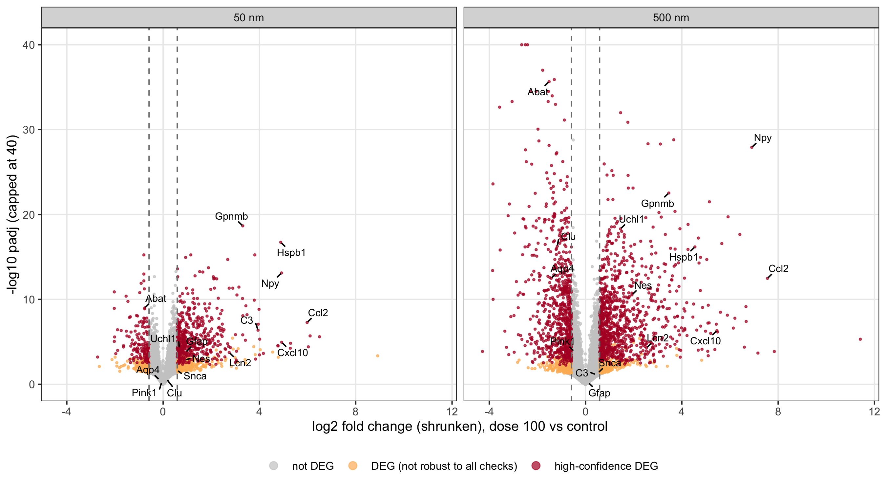
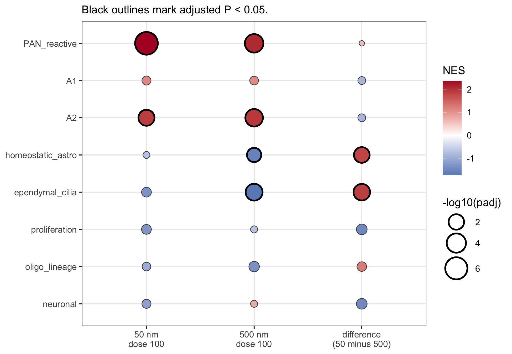
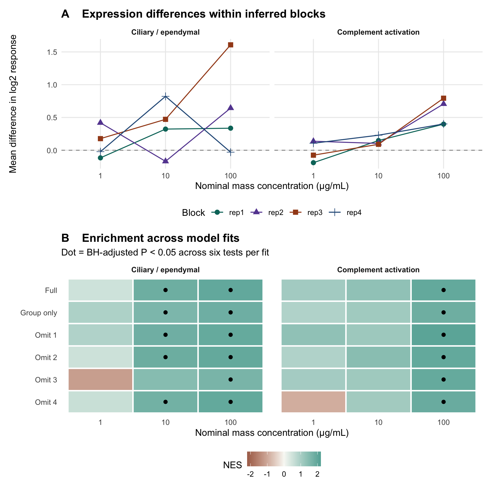

Mohammad Javad Eslami

Independent researcher, Tehran, Iran

Corresponding author: Mohammad Javad Eslami, mohamadjavadeslami10@gmail.com

## Abstract

**Background** After seven days of polystyrene exposure, rat astrocyte cultures showed more differentially expressed genes with 500 nm particles than with 50 nm particles. To determine which responses differed between the preparations at equal nominal mass concentrations, I reanalysed the 32 bulk RNA sequencing libraries from that experiment.

**Results** At 100 µg/mL, the mean log₂ fold change across 18 complement genes was +0.32 for 50 nm particles and −0.27 for 500 nm particles, each relative to its own control. The difference (+0.589) exceeded the mean for genes matched on their estimated 500 nm responses (+0.132). The excess was +0.457 (one-sided empirical P = 0.000050, adjusted P = 0.00015 across three post hoc sets). The original ciliary and homeostatic lists showed little excess (+0.006 and +0.106). A broader, externally defined astrocyte list showed a smaller excess than complement (+0.179, adjusted P = 0.021). At high dose, the number of significant gene-level differences fell from 990 to 89 when inferred sample blocks were omitted from the model. At 10 µg/mL, omitting one block weakened ciliary enrichment.

**Conclusions** At high dose, the mean contrast for the selected complement gene set exceeded that of gene sets matched on their estimated 500 nm responses. Whether this transcriptional difference extends to complement activity remains open.

**Keywords** Polystyrene, astrocytes, complement, bulk RNA sequencing, gene set enrichment, cilia, nanoplastics

## Background

Marcellus and colleagues exposed rat neural stem cell-derived astrocytes to 50 and 500 nm polystyrene particles [1]. After seven days at 100 µg/mL, they reported 531 differentially expressed genes in the 50 nm series and 1,274 in the 500 nm series. Of these, 339 increased and 82 decreased in both. A gene can meet a significance threshold in just one series even when its responses are similar. The deposited RNA sequencing (RNA-seq) libraries allow a direct comparison of the two changes from control at each of three concentrations [2].

Primary mouse astrocytes synthesize C3 and can secrete factor B after inflammatory stimulation [3]. Cultured human astrocytes also express inflammatory and stress responses after short-term polystyrene exposure [4]. Other transcripts in these cultures may reflect cellular identity. For example, *Foxj1* contributes to ependymal differentiation and marks a subset of astrocytes in the developing mouse brain [5]. In bulk RNA, its abundance depends both on expression within cells and on how many cells express it.

The high-dose data prompted closer examination of complement, ciliary and homeostatic genes. For each set, I asked whether the difference between preparations was unusually large among genes with comparable responses to 500 nm particles. The matched comparison used the blocked model. Separate analyses examined how marker choice affected enrichment and how inferred sample blocks affected enrichment and gene-level discoveries.

## Methods

### Cultures, exposures and sample identifiers

The source experiment used astrocyte cultures differentiated from fetal rat neural stem cells [1]. GSE256038 contains 32 paired-end RNA-seq libraries collected after seven days of exposure. Each particle series comprised its own unexposed control and three nominal concentrations (1, 10 and 100 µg/mL), with four libraries per group [1,2]. All libraries were included. The source paper reports four samples for RNA extraction and describes three biological replicates for the in vitro experiments generally. It does not explain how those counts relate.

Each GEO accession was matched to its sequencing run and BioSample record. Within every group, the four BioSample titles ended in 01 through 04 in the same order as the GEO accessions. These suffixes defined four candidate blocks. Neither the records nor the paper identifies whether matching suffixes correspond to a culture, an experimental day or a technical batch. Principal component scores were calculated from the 500 most variable genes after variance stabilization and regressed on suffix.

### Read processing and comparison with the published results

The paired FASTQ files were checked against European Nucleotide Archive MD5 checksums. [FastQC](https://www.bioinformatics.babraham.ac.uk/projects/fastqc/) and fastp [6] assessed read quality, and MultiQC [7] combined the reports. Salmon 2.8.0 quantified the original reads using automatic library-type detection and correction for sequence and GC bias [8]. The index comprised Ensembl release 116 rat cDNA and noncoding RNA sequences (GRCr8, k = 31) without genomic decoys. Transcript identifiers were matched to gene annotations from the same release after stripping version suffixes. tximport 1.40.0 supplied gene-level counts and sample-specific length offsets to DESeq2 1.52.0 [9,10]. Genes with at least ten counts in at least four libraries entered the analysis.

The primary negative-binomial model included an eight-level exposure group and a four-level suffix block as additive fixed effects. A second model used exposure group alone. In the reanalysis, inclusion in a within-series high-dose discovery list required a Benjamini–Hochberg (BH) adjusted Wald P value below 0.05 and an absolute apeglm-shrunken log₂ fold change of at least log₂(1.5) [11,12]. Published genes were matched by Ensembl identifier. Where an identifier was absent, a unique symbol in both annotations was used, excluding conflicts with direct matches. Published discoveries were defined from the deposited adjusted P values (< 0.05) and signed fold changes (absolute value ≥ 1.5). Recovery was the fraction of matched published discoveries that also met the reanalysis criteria.

To assess the observed arrangement of suffixes, I shuffled the four labels independently within each group, retaining the number of model parameters. I refitted DESeq2 for 39 shuffles (seed 20261113) and counted genes at BH-adjusted P < 0.05 for each high-dose exposure versus its own control. The observed and shuffled counts used the same DESeq2 contrast extraction.

### Comparing responses between the particle series

For each nonzero concentration, the direct contrast on the log₂ scale was (50 nm exposure − 50 nm control) − (500 nm exposure − 500 nm control). A positive difference can arise when a gene increases more in the 50 nm series or decreases more in the 500 nm series. Direct tests used unshrunken coefficients, DESeq2 independent filtering and BH adjustment within each contrast. Gene-specific intervals are pointwise 95% Wald intervals. A three-degree-of-freedom likelihood-ratio test compared a model with a series-by-categorical-dose interaction against one with only series and dose main effects. Both included block.

Each leave-one-block-out fit retained 24 libraries and the original gene universe. Normalization and dispersions were re-estimated. For each block I also calculated a descriptive response difference from log₂(normalized count + 0.5). I recorded agreement in sign across the four block estimates, agreement in sign and significance across the four omission fits, and significance in the group-only model. For within-series comparisons the same sign and omission checks were applied to each high-dose change relative to its control (Fig. 1). For sample 500C-03, an auxiliary regression compared the within-block change from control with the two high-dose expression profiles estimated from the other three blocks. The relative coefficients reflect resemblance to the particle series. As an abundance check, I restricted the reported direct contrasts using three abundance cutoffs (mean normalized count of at least 10, 20 or 50), keeping the original genome-wide adjustment.

### Gene sets and their provenance

An initial screen examined Gene Ontology (GO) biological processes, KEGG pathways and eight marker lists. The pan-reactive, A1 and A2 categories came from work in mice [13]. The categories were of interest before the analysis, but I reconstructed the original gene lists from memory after examining the high-dose data. I selected the homeostatic astrocyte and ciliary/ependymal markers by hand after observing the change in *Aqp4* and enrichment for cilium movement and axoneme genes. *Foxj1* and *Dnah9* contributed to the signal that motivated the ciliary list. I also assembled the proliferation, oligodendrocyte-lineage and neuronal lists by hand. The exploratory eight-list analysis ranked mapped genes with evaluable adjusted P values using statistics reconstructed from the exported estimates and standard errors.

Three sets were selected for follow-up: the ciliary and homeostatic lists and the GO term *complement activation* ([GO:0006956](https://amigo.geneontology.org/amigo/term/GO:0006956)). Rat complement genes were obtained from org.Rn.eg.db, including annotations to descendant terms. For preranked gene set enrichment analysis (GSEA) in clusterProfiler, genes were ranked by finite, full-precision DESeq2 Wald statistics [14,15]. Where identifiers shared a gene symbol, the one with the largest absolute statistic was retained, with identifier order breaking ties. Eligible sets contained 4–500 represented genes. The normalized enrichment score (NES) describes where members lie in the ranking. In the direct contrast a positive score denotes enrichment among genes with a more positive response to 50 nm particles.

The high-dose follow-up used BH adjustment across three sets per fit. The across-dose analysis tested ciliary and complement genes at all three nonzero doses, with BH adjustment across six tests per fit. For tests common to both analyses, the rankings, NES and unadjusted P values were identical. I examined the leading edge (genes contributing to the enrichment peak) and repeated high-dose GSEA after omitting each ciliary or complement member in turn. The 25 resulting P values were adjusted together. Gene omissions and block omissions assess sensitivity using overlapping sets or samples.

### Comparison with genes matched on their 500 nm response

At 100 µg/mL I summarized the response in each series by its median absolute log₂ fold change and estimated the through-origin slope of the 50 nm changes against the 500 nm changes. I then used the unshrunken model estimates to construct a comparison for each selected set. Genes were ranked by their signed 500 nm response. For each set member, one gene was drawn uniformly from within 50 ranks on either side, including the member itself and truncating the window at the ends. Draws were independent across members and could repeat a gene. This procedure generated 20,000 sets of the same size (seed 20261115). The excess was the observed mean direct contrast minus the mean across simulated sets. The one-sided empirical P value was one plus the number of simulated means at least as large as the observed mean, divided by 20,001. BH adjustment covered the three selected sets.

### Externally defined marker lists

Before repeating the analyses with external lists, I recorded the selection rules, date and membership in version control. I transcribed the mouse pan-reactive, A1 and A2 panels in Fig. 1a and Extended Data Fig. 12a of Liddelow et al. and compared the labels with the rat and mouse primer tables [13]. The panels list *Ugt1a*, where the reconstructed list had *Ugt1a1*. I followed the panel label *Hspb1* where the primer tables print *Hsbp1*. Additional file 2 records symbol normalization and unmatched genes. I also took all mouse-supported astrocyte and ependymal markers from the [27 March 2020 marker release](https://panglaodb.se/markers/PanglaoDB_markers_27_Mar_2020.tsv.gz) of PanglaoDB [16]. Additional file 2 documents the archived copy used. Symbols were matched case-insensitively to the rat ranking without imputing missing orthologues. These lists represent broader cellular identities than the hand-selected panels. High-dose GSEA used the full blocked model and BH adjustment across the five external lists per contrast. The two PanglaoDB lists were also evaluated against matched backgrounds from the full blocked model, with BH adjustment over these two tests.

### Computational assistance and reproducibility

OpenAI Codex assisted with code execution, checks against the result tables, and manuscript drafting and revision. A review using Claude examined the archived tables and suggested sensitivity analyses. A separate restart on the original machine from the tximport object reproduced the six principal gene counts reported for the direct comparisons. The author takes responsibility for the analyses and their interpretation.

## Results

### Reprocessing recovered the published high-dose responses

Salmon inferred the same inward-facing, reverse-stranded library orientation for all 32 samples. Mapping rates ranged from 83.9% to 88.1%. Of 42,687 quantified genes, 16,726 passed the count filter. At 100 µg/mL, 1,028 genes in the 50 nm series and 2,215 in the 500 nm series met both the adjusted P value and 1.5-fold criteria (Fig. 1). Of these, 610 and 1,741, respectively, also met the within-series stability criteria.

Of the 531 discoveries originally reported for 50 nm particles, 497 could be matched to the filtered data, and 474 of these (95.4%) were recovered. For 500 nm particles the corresponding figures were 1,156 of 1,274 matched and 1,122 of 1,156 (97.1%) recovered. Every recovered gene agreed in direction with the published result. Across all matched genes within each series, Spearman correlations with the published high-dose log₂ fold changes were 0.93 and 0.94.

The sample suffix explained 78% of variation in the second principal component and 91% in the third. In the comparison with shuffled labels, the observed arrangement yielded 4,320 and 5,736 high-dose discoveries at adjusted P < 0.05 for 50 and 500 nm, respectively, using significance alone. Counts across the 39 shuffles ranged from 1,382 to 1,662 and from 2,839 to 3,186. The suffix therefore captured expression structure across groups, although its experimental origin remains unknown.

### High-dose differences depended on the block model

The joint series-by-dose test identified 852 genes at adjusted P < 0.05. In the dose-specific tests, one gene met that threshold at 1 µg/mL, none at 10 µg/mL and 990 at 100 µg/mL. Of the 13,807 genes with an evaluable adjusted P value at 100 µg/mL, 707 had a significant positive contrast and 283 a significant negative contrast.

All 990 kept the same sign in each of the four block-omission fits. For 926, the observed contrast had that sign in all four individual blocks as well. Of these, 144 also remained significant in every omission fit. Restricting the results to a mean normalized count of at least 20 retained 987 of the 990 genes and all 144. In the group-only model, 89 genes had a significant high-dose difference. All 89 agreed in sign and significance with the full model, and 50 belonged to the group of 144.

### Complement genes differed more than genes with similar 500 nm responses

Across 16,726 genes, the median absolute shrunken log₂ fold change was 0.113 for 50 nm particles and 0.162 for 500 nm particles. The slope of 50 nm estimates regressed on 500 nm estimates through the origin was 0.483. Without shrinkage the medians were closer (0.207 and 0.223), and the slope was 0.453. The slope summarizes an association between two estimated quantities and depends on which series is used as predictor.

Across 18 complement genes, the mean unshrunken exposure response relative to control was +0.319 log₂ units for 50 nm and −0.269 for 500 nm particles. The resulting difference of +0.589 exceeded every one of the 20,000 simulated set means obtained by matching on the 500 nm response. The average matched difference was +0.132 (Table 1). The ciliary genes had an even larger observed difference (+0.745), but almost the same mean was observed among their matched genes (+0.739). The original homeostatic list also showed little evidence of an excess.

**Table 1. High-dose response differences for selected gene sets and their matched backgrounds.**

| Gene set (genes) | Observed | Matched mean | Excess | Adjusted P |
|:---|---:|---:|---:|---:|
| Complement (18) | +0.589 | +0.132 | +0.457 | 0.00015 |
| Ciliary/ependymal (7) | +0.745 | +0.739 | +0.006 | 0.480 |
| Homeostatic astrocyte (10) | +0.470 | +0.364 | +0.106 | 0.377 |

Differences compare the two high-dose responses, each measured relative to its own unexposed control on the unshrunken log₂ scale. Excess is the observed mean minus the matched mean. The P values come from one-sided gene resampling with BH adjustment across the three sets.

Individual complement genes contributed in different ways (gene-level estimates in Additional file 2). At adjusted P < 0.05, six members increased and three decreased in the 50 nm series. One increased and nine decreased in the 500 nm series. No member showed both a significant increase at 50 nm and a significant decrease at 500 nm. For example, *C3* had a positive estimate in both series, with a larger response at 50 nm. Its direct contrast was +2.65 log₂ units (genome-wide adjusted P = 0.090). Four other complement genes (*Clu*, *C1r*, *Cd59b* and *Cfb*) met the genome-wide threshold for a direct difference in the blocked model. *Clu* and *C1r* met the sign and significance criteria in every omission fit. No complement gene met the genome-wide threshold for the direct contrast in the group-only model.

### Enrichment of marker sets at the highest concentration

Pan-reactive and A2 markers were enriched among genes that increased in each particle series. The homeostatic and ciliary lists were enriched among genes that decreased in the 500 nm series and had positive enrichment scores in the direct contrast (Fig. 2). In the exploratory GO screen, the term *complement activation* also had a positive score on the direct contrast (NES 1.88, adjusted P = 0.0084).

In the targeted high-dose GSEA, complement and ciliary genes remained enriched in all six fits (Table 2). The homeostatic list met the threshold in five, with adjusted P = 0.063 when block 2 was omitted. Removing any one member from the complement or ciliary list preserved enrichment at high dose (largest adjusted P across 25 omissions, 0.0027).

**Table 2. Enrichment of the three selected gene sets in the high-dose contrast.**

| Gene set | Genes | NES | Adjusted P | Significant fits |
|:---|---:|---:|---:|---:|
| Complement | 18 | 1.97 | 0.00058 | 6/6 |
| Ciliary/ependymal | 7 | 1.98 | 0.00015 | 6/6 |
| Homeostatic astrocyte | 10 | 1.92 | 0.00058 | 5/6 |

NES and adjusted P are from the full blocked model. The final column counts fits at BH-adjusted P < 0.05 across three sets per fit. The six fits comprise the full blocked model, the group-only model and four models each omitting one block.

Five of seven ciliary genes decreased significantly in the 500 nm series, including *Dnah9*, *Dnah5* and *Foxj1*. Only *Dnah9* and *Dnah5* decreased significantly in the 50 nm series. Six of ten homeostatic genes decreased significantly at 500 nm, including *Atp1a2*, *Aqp4*, *Glul* and *Gja1*, and none did so at 50 nm. Here, significance refers to BH-adjusted P < 0.05 within each series. Two genes illustrate how blocking affected the direct comparison. For *Foxj1* the difference was +0.81 log₂ units (95% interval 0.51–1.12) and for *Gja1* it was +1.15 (0.74–1.57). Both met the sign and significance criteria in the block-omission analysis. Without blocking, only *Gja1* met the genome-wide threshold (adjusted P = 0.022 for *Gja1* and 0.76 for *Foxj1*).

### External marker lists and expression of cell-identity genes

The rat rankings contained 58 of 63 mouse-supported astrocyte markers and 44 of 59 ependymal markers from PanglaoDB. Both lists were enriched among genes with a more positive response at 50 nm than at 500 nm (NES 2.51 and 2.26, adjusted P = 1.0 × 10⁻⁹ and 9.6 × 10⁻⁷). In the separate matched analysis, the broader astrocyte list exceeded its background (+0.179 log₂ units, adjusted P = 0.021). The ependymal estimate was +0.144 (adjusted P = 0.067). For the source-checked Liddelow lists, 11 of 13 pan-reactive, 7 of 12 A1 and 9 of 12 A2 markers were represented. Pan-reactive and A2 enrichment was positive and significant in each series. A1 enrichment was not significant, and none of the three lists showed significant enrichment in the direct contrast (Additional file 2).

Group means for individual markers are reported in Additional file 1. In the 500 nm series, mean normalized counts for the progenitor marker *Nes* rose from 4,072 in controls to 13,240 at 100 µg/mL. Over the same comparison, *Aqp4* fell from 35,518 to 13,003. The corresponding changes at 50 nm were smaller (*Nes*, 3,335 to 5,848 and *Aqp4*, 35,650 to 28,951). *Gfap* showed the larger rise at 50 nm (+1.04 versus +0.18 log₂ units). These summaries describe bulk expression.

### The intermediate-dose ciliary signal was sensitive to one block

At 100 µg/mL the mean complement contrast was positive in each individual block (+0.40 to +0.79 log₂ units). Ciliary scores ranged from −0.03 to +1.61, with the largest difference in block 3 (Fig. 3A). At 10 µg/mL ciliary enrichment was positive in all six fits. Omitting block 3 lowered the NES from 1.82 to 1.46 and raised the adjusted P value from 0.0056 to 0.161. The full-model leading edge comprised *Rsph4a*, *Dynlrb2*, *Dnah5*, *Foxj1* and *Dnah9*. No fit found significant complement enrichment at 10 µg/mL or significant enrichment for either set at 1 µg/mL (Table 3).

**Table 3. Enrichment of ciliary and complement genes across exposure concentrations.**

| Dose (µg/mL) | Gene set | NES | Adjusted P | Significant fits |
|---:|:---|---:|---:|---:|
| 1 | Ciliary/ependymal | 0.51 | 0.974 | 0/6 |
| 1 | Complement | 1.09 | 0.377 | 0/6 |
| 10 | Ciliary/ependymal | 1.82 | 0.0056 | 5/6 |
| 10 | Complement | 1.33 | 0.202 | 0/6 |
| 100 | Ciliary/ependymal | 1.98 | 0.0003 | 6/6 |
| 100 | Complement | 1.97 | 0.0016 | 6/6 |

NES and adjusted P are from the full blocked model. The final column counts significant results in the six fits defined in Table 2. Here the BH adjustment covers two sets at three doses within each fit, accounting for the difference from the high-dose adjusted P values in Table 2.

## Discussion

Marcellus and colleagues found an inflammatory transcriptional response to both preparations [1]. Comparing the two responses directly revealed a difference within that broader pattern. At 100 µg/mL, complement transcripts rose on average in the 50 nm series and fell in the 500 nm series. Genes with similar estimated 500 nm responses elsewhere in the transcriptome showed a smaller mean difference. Individual complement genes behaved differently: *C3*, for example, had positive estimates in both series. The experiment measured RNA abundance and provides no direct measure of protein secretion, complement cleavage or downstream activity.

Ciliary genes consistently ranked near the positive end of the between-series contrast, including after omission of individual blocks or genes. Their larger decline in the 500 nm cultures was typical, however, of other genes with comparable 500 nm responses. The hand-selected homeostatic list behaved similarly. The broader PanglaoDB astrocyte list exceeded its matched background. The size and membership of the lists both differ, so these results alone cannot assign the difference to a particular biological programme.

The rise in *Nes* alongside the fall in *Aqp4*, *Gja1* and *Glul* in the 500 nm cultures is consistent with a shift in cell state or in the relative abundance of cell types. Either could also contribute to the decline in *Foxj1* and other ciliary transcripts [5]. Bulk sequencing cannot distinguish those explanations. The source study’s separate seven-day MTT assay showed lower metabolic activity at 100 µg/mL. The authors described the reduction at 500 nm as a trend [1]. Those measurements cannot establish cell counts or viability in the sequenced samples. Similarly, enrichment of historical pan-reactive and A2 signatures describes expression patterns in these cultures. Functional designations for reactive astrocytes require additional evidence [13,17].

The high-dose data guided the choice of all three follow-up sets and the membership of the two hand-selected lists. Some ciliary genes helped generate the GO result that prompted their selection. BH adjustment covers the tests reported in each family and cannot account for that selection. The 500 nm estimate also enters both the matching procedure and the direct contrast. Resampling the fitted gene estimates does not propagate that uncertainty. Independent draws also omit correlations among pathway members, which can affect competitive gene-set tests [18]. The one-sided empirical P values therefore describe this conditional comparison. External marker definitions reduce dependence on hand selection, but all comparisons use the same cultures.

The sample records do not identify what the recurring suffix represents. Including it greatly increased the number of gene-level discoveries, and omission fits reuse most of the same libraries. At 10 µg/mL, block 3 contains sample 500C-03, whose first principal component score (22.1) lay within the 500 nm high-dose range (17.6–35.5). Its expression profile more closely resembled the 500 nm series. In seven of the eight high-dose samples the larger regression coefficient corresponded to the recorded particle series. This check could not verify the concentration assigned to 500C-03. I retained the submitted label. Omitting the whole block reveals the sensitivity of the intermediate-dose result without isolating the influence of this library. The dose-specific contrasts also do not establish a monotonic trend or an onset threshold.

Equal nominal mass also entails different particle numbers. For ideal spheres of equal density, the 50 nm preparation contains about 1,000 times as many particles and ten times the total geometric surface area as the 500 nm preparation at the same mass. Sedimentation and diffusion can further alter how much material reaches the cells [19]. Particle diameter and these differences in exposure cannot be separated in this experiment.

## Conclusions

Among the three sets selected for follow-up, complement showed the clearest difference beyond its matched background at 100 µg/mL. The larger declines in ciliary and homeostatic markers in the 500 nm series accompanied a rise in *Nes* and a fall in *Aqp4*. Distinguishing a shift in expression within cells from a change in the cells present would require measurements that resolve the individual cell populations.

## Abbreviations

BH, Benjamini–Hochberg. GEO, Gene Expression Omnibus. GO, Gene Ontology. GSEA, gene set enrichment analysis. KEGG, Kyoto Encyclopedia of Genes and Genomes. MTT, thiazolyl blue tetrazolium bromide. NES, normalized enrichment score. RNA-seq, RNA sequencing.

## Declarations

**Ethics approval and consent to participate.** This secondary analysis used public rat RNA-seq data. It involved no additional animals, specimens or human participants. The source study describes the original experimental procedures [1].

**Consent for publication.** Not applicable.

**Availability of data and materials.** GEO accession GSE256038 provides the raw reads through the Sequence Read Archive and the investigators’ differential-expression tables [2]. Earlier analysis versions are archived in Zenodo [20,21]. The v1.3.1 archive contains the analysis code, processed gene-level results, figures, tximport input, rebuilt DESeq2 object and reproducibility audit used for this manuscript [22]. Additional file 1 contains group mean marker counts. Additional file 2 contains gene-set definitions, source audits, complement gene estimates and external-marker sensitivity results.

**Competing interests.** The author declares no competing interests.

**Funding.** The author funded the study with personal resources.

**Authors’ contributions.** MJE designed and conducted the reanalysis, interpreted the results and wrote the manuscript.

**Acknowledgements.** The author thanks Marcellus and colleagues for making the sequencing libraries and gene-level results publicly available [1,2].

## Additional files

**Additional file 1. Group mean expression of cell-type markers.** Additional_file_1.csv contains mean normalized counts across the eight exposure groups for astrocyte, oligodendrocyte-lineage, neuronal, progenitor and proliferation markers.

**Additional file 2. Gene-set definitions, complement estimates and sensitivity analyses.** Additional_file_2.zip contains marker memberships, the source audit, the within-series and between-series estimates for individual complement genes, enrichment with external lists and the matched-background comparisons.

## References

1. Marcellus KA, Bugiel S, Nunnikhoven A, Curran I, Gill SS. Polystyrene Nano- and Microplastic Particles Induce an Inflammatory Gene Expression Profile in Rat Neural Stem Cell-Derived Astrocytes In Vitro. Nanomaterials. 2024;14:429. https://doi.org/10.3390/nano14050429

2. Marcellus KA, Bugiel S, Nunnikhoven A, Curran IH, Gill S. Polystyrene nano- and microplastic particles induce an inflammatory gene expression profile in neural stem cell-derived astrocytes. Gene Expression Omnibus. 2024. GSE256038. https://www.ncbi.nlm.nih.gov/geo/query/acc.cgi?acc=GSE256038

3. Lévi-Strauss M, Mallat M. Primary cultures of murine astrocytes produce C3 and factor B, two components of the alternative pathway of complement activation. Journal of Immunology. 1987;139:2361–2366. https://doi.org/10.4049/jimmunol.139.7.2361

4. Kiran S, Thilanka U, Xue Y, Sang QXA. Polystyrene Micro- and Nanoplastic Exposure Triggers an Activation and Stress Response in Human Astrocytes. International Journal of Molecular Sciences. 2025;26:11273. https://doi.org/10.3390/ijms262311273

5. Jacquet BV, Salinas-Mondragon R, Liang H, Therit B, Buie JD, Dykstra M, et al. FoxJ1-dependent gene expression is required for differentiation of radial glia into ependymal cells and a subset of astrocytes in the postnatal brain. Development. 2009;136:4021-4031. https://doi.org/10.1242/dev.041129

6. Chen S, Zhou Y, Chen Y, Gu J. fastp: an ultra-fast all-in-one FASTQ preprocessor. Bioinformatics. 2018;34:i884-i890. https://doi.org/10.1093/bioinformatics/bty560

7. Ewels P, Magnusson M, Lundin S, Käller M. MultiQC: summarize analysis results for multiple tools and samples in a single report. Bioinformatics. 2016;32:3047-3048. https://doi.org/10.1093/bioinformatics/btw354

8. Patro R, Duggal G, Love MI, Irizarry RA, Kingsford C. Salmon provides fast and bias-aware quantification of transcript expression. Nature Methods. 2017;14:417-419. https://doi.org/10.1038/nmeth.4197

9. Soneson C, Love MI, Robinson MD. Differential analyses for RNA-seq: transcript-level estimates improve gene-level inferences. F1000Research. 2016;4:1521. https://doi.org/10.12688/f1000research.7563.2

10. Love MI, Huber W, Anders S. Moderated estimation of fold change and dispersion for RNA-seq data with DESeq2. Genome Biology. 2014;15:550. https://doi.org/10.1186/s13059-014-0550-8

11. Benjamini Y, Hochberg Y. Controlling the False Discovery Rate: A Practical and Powerful Approach to Multiple Testing. Journal of the Royal Statistical Society Series B: Statistical Methodology. 1995;57:289-300. https://doi.org/10.1111/j.2517-6161.1995.tb02031.x

12. Zhu A, Ibrahim JG, Love MI. Heavy-tailed prior distributions for sequence count data: removing the noise and preserving large differences. Bioinformatics. 2019;35:2084-2092. https://doi.org/10.1093/bioinformatics/bty895

13. Liddelow SA, Guttenplan KA, Clarke LE, Bennett FC, Bohlen CJ, Schirmer L, et al. Neurotoxic reactive astrocytes are induced by activated microglia. Nature. 2017;541:481-487. https://doi.org/10.1038/nature21029

14. Subramanian A, Tamayo P, Mootha VK, Mukherjee S, Ebert BL, Gillette MA, et al. Gene set enrichment analysis: A knowledge-based approach for interpreting genome-wide expression profiles. Proceedings of the National Academy of Sciences. 2005;102:15545-15550. https://doi.org/10.1073/pnas.0506580102

15. Wu T, Hu E, Xu S, Chen M, Guo P, Dai Z, et al. clusterProfiler 4.0: A universal enrichment tool for interpreting omics data. The Innovation. 2021;2:100141. https://doi.org/10.1016/j.xinn.2021.100141

16. Franzén O, Gan LM, Björkegren JLM. PanglaoDB: a web server for exploration of mouse and human single-cell RNA sequencing data. Database. 2019;2019:baz046. https://doi.org/10.1093/database/baz046

17. Escartin C, Galea E, Lakatos A, O'Callaghan JP, Petzold GC, Serrano-Pozo A, et al. Reactive astrocyte nomenclature, definitions, and future directions. Nature Neuroscience. 2021;24:312-325. https://doi.org/10.1038/s41593-020-00783-4

18. Wu D, Smyth GK. Camera: a competitive gene set test accounting for inter-gene correlation. Nucleic Acids Research. 2012;40:e133. https://doi.org/10.1093/nar/gks461

19. Hinderliter PM, Minard KR, Orr G, Chrisler WB, Thrall BD, Pounds JG, et al. ISDD: A computational model of particle sedimentation, diffusion and target cell dosimetry for in vitro toxicity studies. Particle and Fibre Toxicology. 2010;7:36. https://doi.org/10.1186/1743-8977-7-36

20. Eslami MJ. RNA-seq reanalysis of ciliary and complement responses to polystyrene exposure in rat astrocyte cultures. Version 1.2.0. Zenodo. 2026. https://doi.org/10.5281/zenodo.24197910

21. Eslami MJ. Complement transcript responses to two polystyrene particle sizes in rat astrocyte cultures after accounting for response amplitude. Zenodo. 2026. https://doi.org/10.5281/zenodo.24361377

22. Eslami MJ. Complement gene expression in rat astrocyte cultures exposed to 50 or 500 nm polystyrene particles at equal nominal mass concentrations. Version 1.3.1. Zenodo. 2026. https://doi.org/10.5281/zenodo.24390580

## Figure legends

**Figure 1. High-dose responses relative to the control for each particle series.** Each point is a gene with an evaluable adjusted P value. The axes show the apeglm-shrunken log₂ fold change and −log₁₀ adjusted P (capped at 40). Dashed lines mark a 1.5-fold change. Orange and red points meet both the fold-change threshold and adjusted P < 0.05 in the full blocked model. Red points also meet the adjusted P threshold in all four block-omission fits and agree in direction with the full model in every omission fit and every individual block. Grey points fail one or both full-model criteria.

{width=6.1in}

**Figure 2. Exploratory enrichment of eight marker sets at 100 µg/mL.** The first two columns show each response relative to its own control. The third compares those responses directly (50 nm minus 500 nm). Colour indicates NES, point size reflects −log₁₀ adjusted P, and a black outline marks adjusted P < 0.05. The figure uses the original, post hoc marker lists. The pan-reactive, A1 and A2 lists were reconstructed from Liddelow et al. [13]. The other five lists were hand-selected. Results for the separately source-checked lists are in Additional file 2.

{width=5.7in}

**Figure 3. Ciliary and complement responses across doses and model fits.** In panel A each point is the mean between-series response difference for genes in one set, calculated within one inferred block. Lines link doses with the same suffix. In panel B colour indicates NES, and dots mark BH-adjusted P < 0.05 across six tests per fit. Positive values indicate a more positive response in the 50 nm series. The full and group-only models use 32 libraries. Each omission model uses 24.

{width=5.6in}
